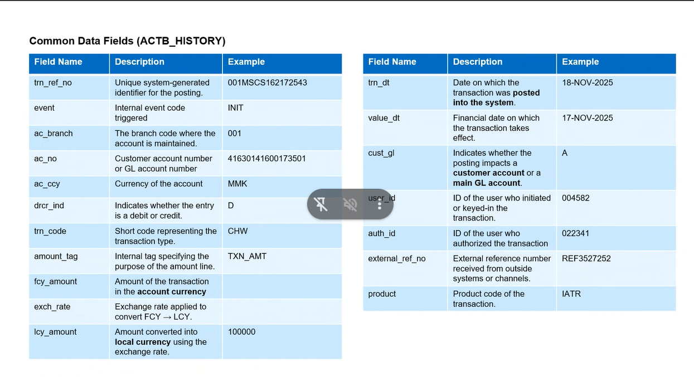

## cbs.actb_history (transaction table)
title:: Transaction and Balance
	- if want to take gl , use cbs.actb_history (take balance from transaction)
	- ```sql
	  select ac_branch,sum(case when drcr_ind = 'C' then lcy_amount else lcy_amount* -1 end) as lcy_bal from cbs.actb_history 
	  where  len(ac_no) = 17 group by ac_branch 
	  order by ac_branch
	  ```
-
- ## base.cbs_acc_bal_trn (Master history)
	- ```sql
	  select branch_code,sum(lcy_bal) as lcy_bal from base.cbs_acc_bal_trn 
	  where is_current = 1 group by branch_code order by branch_code
	  ```
	- cbs.actb_accbal_history--- > base.cbs_acc_bal_trn
	- this is correct for len(ac_no) = 17  (only diff 3000 ks in 999 branch)
-
- 
-