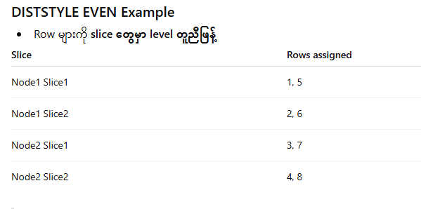
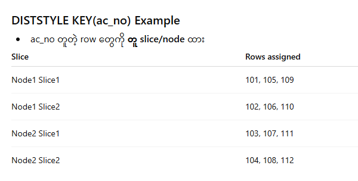
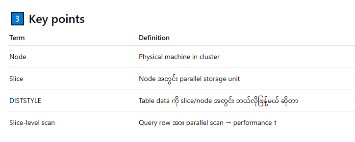

- data are store in slices and parallel scan.
-
- Cluster
   ├─ Node1
   │   ├─ Slice1
   │   └─ Slice2
   └─ Node2
       ├─ Slice1
       └─ Slice2
-
- ## diststyles
- 
-
- **Observation:**
- Slice တစ်ခုချင်း scan → parallel scan → query fast
- Note column သာပေါင်းပြီး scan → slice အလိုက် storage
-
- ------------
-
- 
-
- **Observation:**
- Join queries `ac_no` အပေါ် မှန် → same node → fast
- Note column stored along with row → scan depends on slice
-
- ----------------
-
- ## **DISTSTYLE ALL Example**
- Table ကို **node အားလုံးမှာ copy**
- Node1 Slice1 = 8 rows
- Node1 Slice2 = 8 rows
- Node2 Slice1 = 8 rows
- Node2 Slice2 = 8 rows
  
  Join query → ultra-fast
  
  Storage consumption ↑
-
- 
-
-